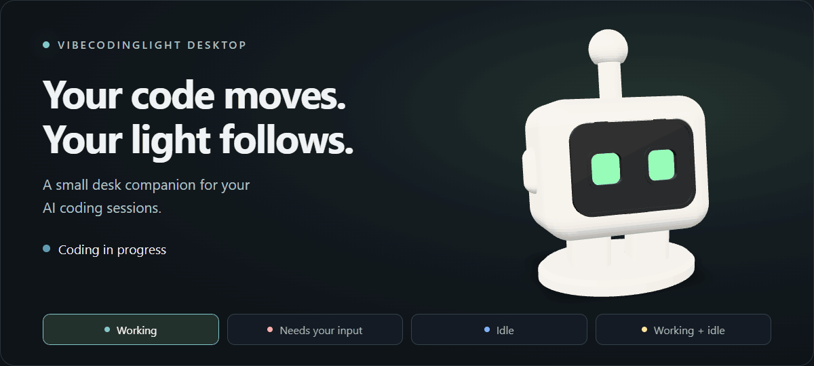
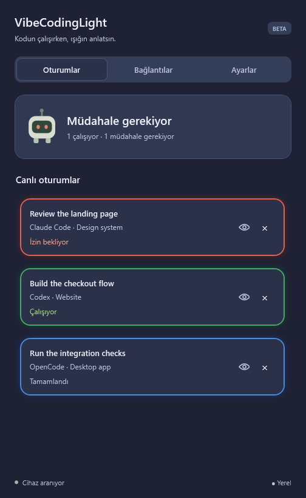
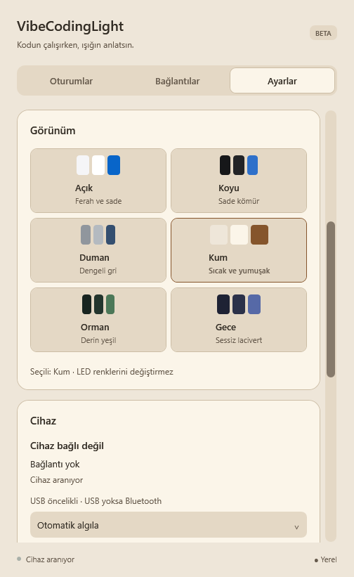
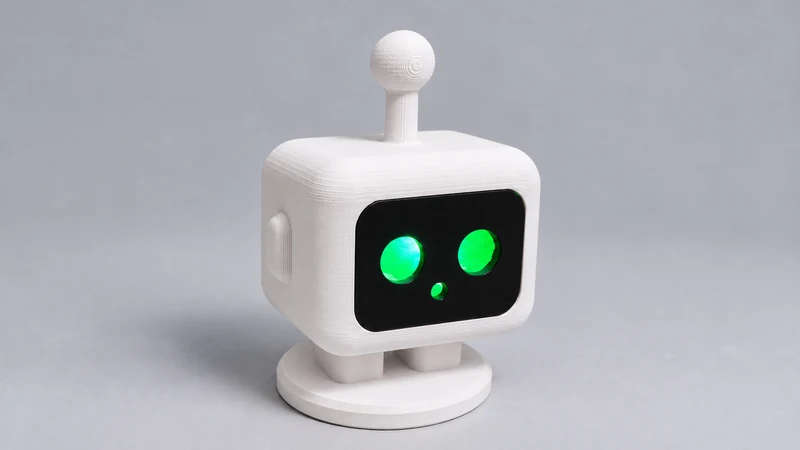

<p align="center">
  
</p>

<h1 align="center">VibeCodingLight Desktop</h1>

<p align="center">Your AI coding sessions. At a glance.</p>

<p align="center">
  <a href="https://www.vibecodinglight.com/#setup"></a>
</p>

<p align="center">
  <a href="https://www.vibecodinglight.com">Meet the robot</a> ·
  <a href="https://github.com/barancavusoglu/vibecodinglight-desktop/releases">Releases</a> ·
  <a href="LICENSE">Apache-2.0</a>
</p>

A desktop companion for the **[VibeCodingLight](https://www.vibecodinglight.com) desk robot**. See when your local AI coding sessions are working, waiting for your input, or ready for the next task. Connect **Codex, Claude Code, and OpenCode** from one app.

## Get started

Paste this into PowerShell to download, verify, and install the Windows app:

```powershell
irm https://www.vibecodinglight.com/install.ps1 | iex
```

Open **Connections** in the app, enable the tools you use, and start a new session. You may need to restart your coding tool after enabling it.

Prefer a manual download? Get the Windows ZIP from [Releases](https://github.com/barancavusoglu/vibecodinglight-desktop/releases), extract it, and run `VibeCodingLight-Setup.exe`.

**Windows x64 beta is available.** macOS is a source preview; a downloadable Mac app is not available yet.

## Inside the app

<table>
  <tr>
    <th>Sessions at a glance</th>
    <th>Six themes, your choice</th>
  </tr>
  <tr>
    <td><a href="assets/readme/windows-sessions.png"></a></td>
    <td><a href="assets/readme/windows-themes.png"></a></td>
  </tr>
</table>

<p align="center"><sub>Windows previews with demo data. The app interface is currently in Turkish.</sub></p>

## A little companion for your desk

<p align="center">
  
</p>

Connect over **USB for power and data**, or use **Bluetooth with external power**. Bring your own USB-C cable; a computer connection needs a data-capable cable.

<p align="center"><sub>Product photograph with AI-assisted background and lighting retouching.</sub></p>

---

Session tracking runs locally. The Windows app can contact the official website to check for updates. Source is public for inspection; this project is owner-maintained, and external contributions and pull requests are disabled.

Licensed under [Apache-2.0](LICENSE). See [NOTICE](NOTICE), [third-party notices](THIRD_PARTY_NOTICES.md), and [security reporting](SECURITY.md).
